# 新版界面设计规格

用户于 2026-11-12 确认。这份规格是 Android App 界面的设计依据，落地顺序见 [`docs/plans/ui-redesign.md`](../../plans/ui-redesign.md)。

设计过程在一张私有画布上完成，其他会话读不到，**仓库里以本目录为准**。

## 1. 这个目录里有什么

| 内容 | 位置 | 用途 |
|---|---|---|
| 截图 | `screens/NN-名称.png` | 每一屏的最终样子，390 × 880，两倍图 |
| 样稿 | `mockups/NN-名称.html` | 同一屏的网页版，可以在浏览器里打开。尺寸、颜色、间距都写在行内样式里，**取数值时以它为准** |
| 本文 | `README.md` | 截图上看不出来的东西：规则、状态、数据从哪来、哪些是示意 |

换算：样稿里的 `px` 按 1:1 当作 `dp`（文字是 `sp`）。样稿按 44 画点击区，实现时沿用项目现有约定，**可点区域不小于 48dp**，看上去的大小按样稿。

样稿联网时会加载等宽字体。中文字体在电脑上没装 IBM Plex Sans SC 时会退回思源黑体，字形以截图为准。

**样稿里的内容是示意数据。** 会话名、步骤数、「214 行」「3 处」「+4 −1」「通过 · 38 秒」这类数字，只在数据能确定时才显示，实现时不要为了和截图一样而编造。

## 2. 设计原则

1. **打开 App 的人只想知道三件事**：有没有事等我、它在干什么、干完的结果是什么。每一屏先回答这三件事。
2. **状态正常时不显示状态。** 电脑连着就只显示名字，出问题才出现文字。
3. **只有一种信号色。** 琥珀色只表示「等你处理」；红色只用于失败、被拒绝的连接和删除。其余全是黑、灰、白。
4. **内容直接落在底色上。** 只有三样东西带白底和描边：首页的进行中卡片、待处理面板、输入框（以及首页上展开的选项面板）。带框就表示「现在需要你」或「可以输入」。
5. **正文舒适，控件紧凑。** 回复正文留足行高；按钮、标签、状态尽量小。
6. **每个数字放在它起作用的地方。** 上下文用量在发送键上，本轮用量在这一轮的结尾，不设单独的信息页。
7. **页面不加大标题。** 顶栏里只有返回和对象名（会话名、电脑名）。
8. **选择在原地展开。** 选项列表出现在触发它的那一行旁边，把别的内容推开。不用浮在上面的菜单，也不用居中的选择对话框（6.10）。

## 3. 颜色

只出了浅色稿。

| 名称 | 值 | 用在哪里 |
|---|---|---|
| 页面底 | `#FAFAF8` | 所有页面的背景 |
| 面板 | `#FFFFFF` | 进行中卡片、待处理面板、输入框、首页上展开的选项面板 |
| 面板描边 | `#E3E2DD` | 上述面板的 1dp 描边 |
| 聚焦描边 | `#16181C` | 展开的输入框 |
| 浅填充 | `#F1F0EC` | 用户气泡、次要按钮、选项胶囊、行内代码、空闲的发送键 |
| 代码底 | `#F4F3EF` | 代码块、改动对比、命令输出 |
| 分隔线 | `#E9E8E3` | 列表行之间、面板内部 |
| 主文字 | `#16181C` | 正文、标题、主按钮的底色 |
| 次要文字 | `#5F646C` | 说明、时间、图标、未选中的切换 |
| 等你（点） | `#C77700` | 待处理的圆点、上下文快满时的外圈 |
| 等你（字） | `#8A5200` | 「想运行命令」「还剩 4:32」「还差一步」等提示 |
| 危险 | `#B3261E` | 失败、已拒绝连接、移除 |
| 转圈轨道 | `#D5D4CE` | 运行中标记的浅色部分 |
| 外圈轨道 / 进度 | `#E3E2DD` / `#5F646C` | 发送键外圈 |
| 新增行 / 删除行 | `#E2ECE1` / `#F3E3DF` | 改动对比里整行的底色 |
| 字符串 | `#46607A` | 代码高亮里唯一的额外颜色 |
| 图片占位 | `#ECEBE6` | 附件缩略图加载前 |

输入框展开时，后面的页面盖一层 78% 的页面底色；首页上有选项展开时，其余内容盖一层 60% 的页面底色。全应用没有带阴影的浮层。

次要文字在页面底上的对比度约 5.9:1。新加的灰色文字不要比它更浅。

**深色模式没有出稿。** 下面是按同样的关系推出来的取值，只是起点，需要用户看过真机效果后确认（见落地方案第 7 节）：

| 名称 | 建议值 | 名称 | 建议值 |
|---|---|---|---|
| 页面底 | `#131416` | 主文字 | `#ECEDEF` |
| 面板 | `#1B1D20` | 次要文字 | `#A0A5AD` |
| 面板描边 | `#34373C` | 等你（点 / 字） | `#E0A040` / `#E9C58F` |
| 浅填充 | `#24272B` | 危险 | `#FFB4AB` |
| 代码底 | `#1E2023` | 新增行 / 删除行 | `#1F2E22` / `#3A2523` |
| 分隔线 | `#2A2D31` | 字符串 | `#9DB4CC` |

## 4. 字体与字号

- **界面和正文**：IBM Plex Sans SC，字重 400、500、600。中文和英文都用它，不再单独打包 Inter。许可是 SIL OFL 1.1，保留字体名为「Plex」，所以直接使用官方原始字体文件，不要裁剪或改名后仍叫 Plex。
- **代码**：JetBrains Mono，字重 400、600（现在打包的是 400 和 500，需要补 600，或者用 500 代替）。

| 用途 | 字号 / 行高（sp） | 字重 |
|---|---|---|
| 首页的电脑名、单台电脑的名字 | 17 / 24 | 600 |
| 顶栏里的会话名、列表行标题 | 15 / 22 | 500；未读 600；已读的最近会话 400 |
| 回复正文 | 15 / 26 | 400，强调 600 |
| 用户气泡、输入框里的字 | 15 / 24 | 400 |
| 面板里的问题 | 15 / 24 | 600 |
| 说明、状态 | 13 / 20 | 400 |
| 列表行第二行 | 12.5 / 18 | 400 |
| 顶栏第二行、时间、角标 | 12 / 16 | 400 |
| 胶囊按钮 | 13 | 400；主按钮 600 |
| 整行的大按钮 | 14–15 | 600 |
| 代码块 | 12.5 / 20，等宽 | 400；关键字 600 |
| 改动对比、命令输出 | 12 / 20，等宽 | 400 |
| 行内代码、命令 | 12.5–13，等宽 | 400 |

## 5. 尺寸与形状

- 页面左右边距 20；输入区左右 16，底部在系统导航栏之上再留一点空。
- 顶栏内容高 44，返回键图标 20。
- 列表行上下内边距 11–14，两行文字之间 2。行与行之间一条分隔线，不加卡片。
- 圆角：用户气泡 18；进行中卡片 20；待处理面板 22；输入框收起时高 52、全圆角，展开时 22；代码块 14；改动对比和命令输出 12；首页上展开的选项面板 20；胶囊按钮全圆角。
- 胶囊按钮看上去高 32–34，发送键直径 40。

## 6. 组件

### 6.1 状态标记

| 状态 | 标记 |
|---|---|
| 等你处理 | 直径 8 的琥珀色实心圆点 |
| 运行中 | 直径 10 的细圆环，四分之一是主文字色，其余是转圈轨道色，持续旋转 |
| 其他 | 没有标记 |

失败、已停止、结果待确认用文字表示，见 7.1。

### 6.2 胶囊按钮

主操作是主文字色底、白字、字重 600；次要操作是浅填充底、主文字色字。两个并排时，**主操作在右边**。选项胶囊（提问的选项）都用次要样式。

### 6.3 输入框

所有会话页和首页用同一个输入框，有两种状态。

**收起**（没有焦点）：一行，从左到右是加号、占位文字、发送键。

**展开**（获得焦点）：描边变成主文字色，分两行。上面是输入的文字，下面一行从左到右是加号、模型、审批方式、发送键。模型和审批方式是带小箭头的文字，点了在输入框里展开选项（6.10）。

首页上的展开状态多一行在最上面：`项目 <项目名>`，点了选项目。见 7.6。

**加号**用来添加图片，功能做出来之前不显示（落地方案 C2）。

**发送键**同时承担三件事：

- 输入框有字：主文字色实心圆，白色向上箭头，点了发送。
- 输入框没字、会话空闲：浅填充实心圆，灰色箭头，不可点。
- 输入框没字、会话运行中：主文字色实心圆，白色方块，点了停止。

**发送键外圈**表示上下文用了多少：一圈 2.5 粗的细线，从顶部顺时针画到对应比例，颜色是次要文字色。达到八成后外圈变成琥珀色，发送键左边出现「上下文快满」四个字。长按发送键，用量在输入框里展开（7.11）。用量功能做出来之前不画外圈（落地方案 B4）。新任务还没有上下文，只画轨道。

占位文字随场景变化：首页「新任务」；会话运行中「补充一句」；会话空闲「继续对话」；有审批时「或者告诉它换个做法」；有提问时「或者用自己的话回答」。

### 6.4 用户气泡和发送状态

气泡靠右，浅填充底，最宽 280。气泡下方可以有一行 12 号灰字说明这条消息的状态，正常送达后不显示：

| 情况 | 文字 |
|---|---|
| 正在发 | 发送中 |
| 已受理，插话模式，还没出现在会话里 | 已送出，DSH 下一步会读到 |
| 已受理，排队模式 | 已排队，本轮结束后处理 |
| 失败 | 发送失败 · 重试 |
| 不确定是否送达 | 不确定是否送达 · 查看 · 重发 |

「不确定是否送达」不能自动重发，只能由用户点。

### 6.5 回复正文和代码

- 正文没有头像、没有名字、没有气泡，直接排在页面上。段落之间 18。
- **行内代码**：等宽 13 号，浅填充底，圆角 5，左右各留 5。
- **代码块**：代码底，圆角 14。顶部一行高 44，左边是灰色等宽小字（知道文件名就显示文件名，否则显示语言名，都不知道就留空），右边是复制按钮。代码不折行，可以横向滑动，右边缘有一段渐隐提示后面还有内容。高亮只有三种区别：关键字加粗、字符串用字符串色、注释用次要文字色。

### 6.6 过程

一轮里的思考和工具调用默认折成一行灰字：`5 个步骤 · 改了 2 个文件 ›`。没有改文件就只写步骤数。点了在原地展开，再点收起。

展开后每一步一行，高 44，行间一条分隔线。从左到右：

- 动作，两个字，灰色，宽 28；
- 对象，等宽，一行，超出用省略号；
- 结果，灰色小字，只在数据能确定时显示。

动作由工具名决定：

| 工具 | 动作 | 对象 |
|---|---|---|
| `bash`、`pwsh` | 运行 | 命令的第一行 |
| `read`、`read_image` | 读取 | 文件名 |
| `write` | 写入 | 文件名 |
| `edit` | 修改 | 文件名 |
| `grep`、`glob` | 搜索 | 搜索的内容 |
| `web_fetch` | 打开 | 网址 |
| `web_search` | 搜网 | 关键词 |
| 思考 | 思考 | 不显示对象，右边显示用时（能确定时） |
| 其他 | 调用 | 工具名 |

步骤的状态：运行中在行首换成转圈标记；失败在结果位置写红色「失败」；被拒绝写「已拒绝」。

点某一步展开它的详情：

- **修改**：改动对比块。代码底，圆角 12，等宽 12 号。每行最左边一列是符号：新增行 `+`，整行新增行底色；删除行 `−`，整行删除行底色，文字用次要文字色；上下文行没有符号，文字用次要文字色。不能只靠颜色区分。
- **运行**：命令输出块。顶部一行写「输出的最后 N 行」，右边是「全部 M 行」。默认只显示最后 4 行，因为结果通常在末尾。
- **其他**：沿用现在的参数和结果显示。

### 6.7 每一轮的结尾

一轮结束后，最后一段回复下面有一行 12.5 号灰字，各段用间隔号隔开，拿不到的段就不显示：

`本轮结束 · 4 分 50 秒 · 61k token · 缓存命中 71%`

第一段随结果变化：本轮结束、已停止、失败（红色，后面跟原因）、结果待确认。**不写「已完成」**：运行结束不等于需求完成。

运行中，对话末尾是一行状态：转圈标记、正在做的那一步、右边「本轮 4:12 · 约 48k token」。

### 6.8 待处理面板

审批和提问出现在会话页底部，压在输入框上方：面板底，面板描边，圆角 22。面板上面仍然能看到 DSH 刚说的话。

第一行是琥珀色圆点加一句琥珀色小字，说明是什么事。审批见 7.4，提问见 7.5。

### 6.9 计划条

会话顶栏下面的一行，高 44，上下各一条分隔线：`第 3 步，共 5 步`（灰色）加当前步骤的名字，最右边一个小箭头。点了打开计划页（7.12）。没有计划数据的会话不显示这一行。**不画进度条，不显示百分比。**

### 6.10 原地展开的选择

选模型、审批方式、项目、电脑，以及看用量，都用同一种做法：**选项列表插在触发它的那一行旁边，把别的内容推开，不盖在任何东西上面。** 全应用不用浮在上面的菜单，也不用居中的选择对话框。

2026-11-13 真机走查后改成这样。原来的浮层在真机上有三个问题：它是另一个窗口，会抢走输入焦点，键盘收起、输入框掉到底部；它会和触发它的控件、输入框的描边互相遮挡；固定的宽度装不下长的项目名。

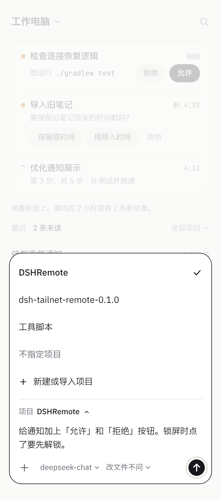

**在输入框里**（模型、审批方式、项目、用量）：

- 选项出现在触发行的**正上方**，输入框卡片向上长，被点的那一行不动。模型、审批方式和用量在最下面一行的上方；项目在「项目」那一行的上方。
- **键盘不收起**，输入的文字和光标保持原样。选项是卡片里的普通内容，不是弹出窗口。
- 选项区和卡片里的其他内容之间用一条分隔线隔开。
- 一次只展开一个。点另一个触发项，就换成它的选项。
- 选中一项后立即收起。再点一次触发项、点输入的文字、按返回键，也会收起。返回键先收起选项，再按一次才收起输入框。键盘弹出时第一次按返回由系统收起键盘，App 收不到，从下一次开始按这个顺序。
- 展开时，触发项的文字换成主文字色、字重 500，小箭头朝上。

> 2026-11-14 起，模型、审批方式、用量改在输入框下面、原来键盘的位置展开（见 `docs/status.md`）。面板的高度跟着选项走，最多和键盘一样高，装不下时在里面滚动；点输入区以外的地方收起，这一下不传给下面的控件。

**在首页上**（电脑、项目筛选）：

- 选项是一张面板（面板底、面板描边、圆角 20，左右各留 20），出现在触发行的**正下方**，下面的内容整体下移。
- 展开时其余内容盖一层 60% 的页面底色，点任何地方收起。

**选项行**：

- 只有名字的行高 48。带说明的行，名字 15 号，下面一行 12.5 号灰字，上下各留 9。
- 当前选中的一项，名字用字重 500，最右边一个勾。不用单选圆圈。
- 名字放不下时折成两行，不截断。右边可以有一个灰色小字（状态、数量）。
- 最多同时显示 5 行，超出时在选项区里上下滚动。
- 展开和收起用 150–200 毫秒的高度变化加淡入淡出，不要弹跳。

审批方式的选项是：只读，改动先问（只能读文件，要改动时先问你）；改文件不问（在项目里可以直接改，超出项目时问你）；全部不问（不再询问，可以访问整台电脑）。DSH 返回了别的审批方式时（例如 `auto`）照常列出，名字用 DSH 给的，没有说明就只显示名字。

模型的选项是模型名，下面一行灰字写来源。

## 7. 各屏说明

### 7.1 首页

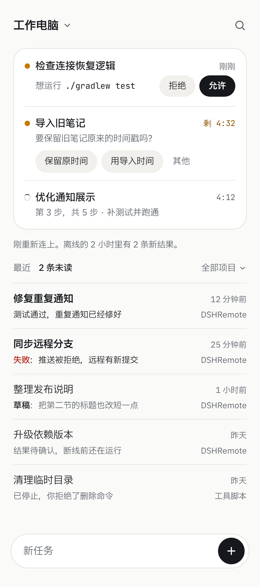

从上到下：

**顶栏。** 左边是当前电脑的名字和一个小箭头，点了在下面展开电脑列表（7.7）。右边的搜索图标是为以后的会话搜索预留的，**搜索做出来之前不要放**。

**进行中卡片。** 等你处理的会话和正在运行的会话放在一张面板里，等你处理的在前。没有这两类会话时，整张卡片不显示。

- 审批：第一行是琥珀点、会话名、时间；第二行左边是「想运行」加命令（等宽，超出省略），右边是「拒绝」「允许」两个胶囊。点会话名进会话。
- 提问：第一行同上；第二行是问题；第三行是前两个选项的胶囊和一个「其他」。点选项直接回答，点「其他」进会话。多选题、多个问题的提问不在首页给选项，只显示问题，点了进会话。限时提问在时间的位置显示琥珀色「剩 4:32」。
- 运行中：第一行是转圈标记、会话名、已运行的时间；第二行是当前在做什么（有计划就写「第 3 步，共 5 步 · 步骤名」）。

不属于任何会话的待处理事项（子代理发起的）也放在这张卡片里，标题用事项本身的说明。

**重连提示。** 断线一段时间后重新连上，卡片下面出现一行灰字：「刚重新连上。离线的 2 小时里有 2 条新结果。」用户滑动列表或进入任何会话后消失。

**「最近」一行。** 左边是「最近」；有未读结果时旁边有「2 条未读」，点了只看未读。右边是项目筛选，默认「全部项目」。点它，项目列表在这一行下面展开（规则见 6.10），每个项目右边是它的会话数；选一个就收起，这一行右边换成选中的项目名。

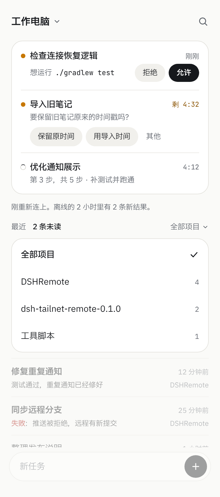

**最近的会话。** 按更新时间倒序，每行两层：

- 第一行：会话名，右边是时间。
- 第二行：左边是这个会话最后的结果，右边是项目名。筛选到单个项目时不显示项目名。

第二行左边的内容：

| 情况 | 显示 |
|---|---|
| 正常结束 | DSH 最后一句话的开头 |
| 失败 | 红色「失败」，后面跟原因 |
| 已停止 | 已停止，后面跟原因（能确定时） |
| 结果待确认 | 结果待确认，断线前还在运行 |
| 有没发出去的草稿 | 主文字色「草稿」，后面跟草稿开头 |

还没看过的结果，标题加粗（600），第二行用主文字色。失败的排在最近列表的前面。

**底部。** 收起的输入框，占位文字「新任务」，右边是带加号的实心圆。点了原地展开（7.6）。

### 7.2 会话

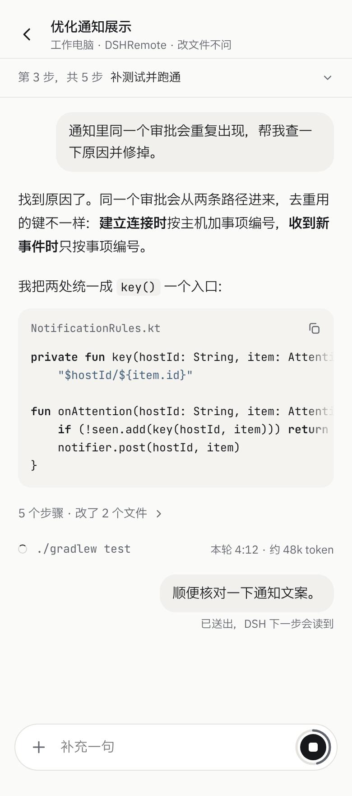

- **顶栏**：返回，会话名，下面一行灰字 `电脑名 · 项目名 · 审批方式`。没有「更多」按钮。
- **计划条**：有计划数据时显示（6.9）。
- **对话**：用户气泡、回复正文、代码块、过程折叠行、运行状态行，规则见第 6 节。
- **输入框**：见 6.3。

### 7.3 过程展开后

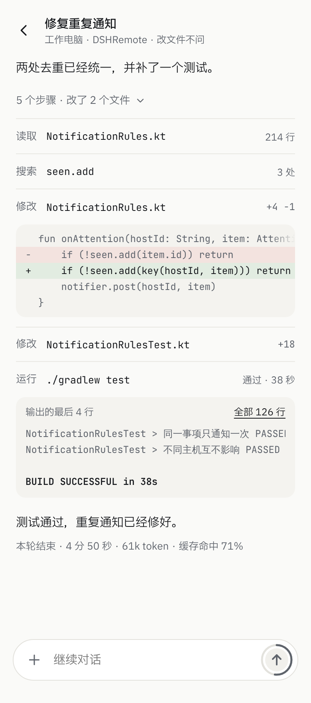

同一个会话页，过程展开后的样子：步骤行、改动对比、命令输出、这一轮的结尾。规则见 6.6 和 6.7。

### 7.4 审批

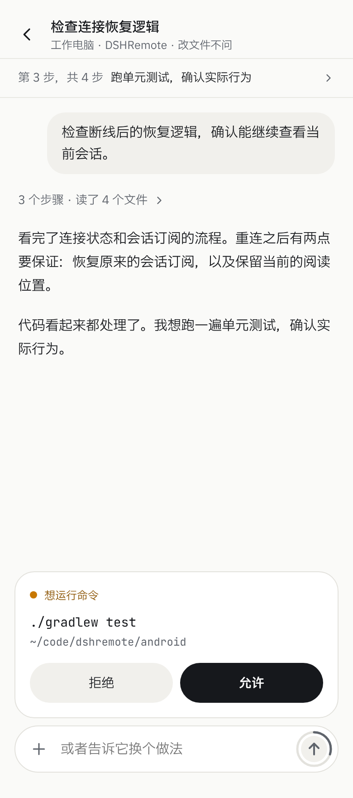

面板内容，从上到下：

1. 琥珀点加一句话：`bash`、`pwsh` 写「想运行命令」；`edit`、`write` 写「想修改文件」；其他写「想使用 <工具名>」。
2. 命令或文件，等宽 14 号，可以折行。
3. 工作目录，等宽 12 号，灰色。
4. 「拒绝」和「允许」各占一半宽，高 44。

插件没能找到对应的工具调用时（协议 5.3），第 2、3 行换成审批的 `reason`。

审批只对这一次有效。没有「以后都允许」，想少被问就在输入框里切换审批方式。

审批在别处被处理后，面板自动收起。

### 7.5 提问

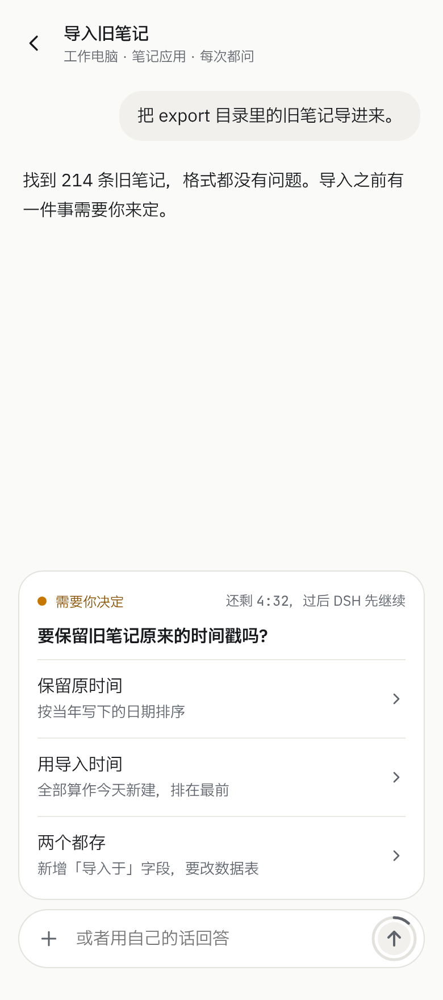

面板内容：琥珀点加「需要你决定」；问题；选项列表，每个选项一行，有说明时在下面用灰色小字，最右边一个小箭头。

- **只有一个问题、而且是单选时，点选项就是回答**，没有提交按钮。
- 多选或多个问题时：选项左边是勾选框，面板底部加一个「回答」主按钮。这种情况没有出稿，按同样的样式做。
- 想自己写答案，用下面的输入框。
- 限时提问在第一行右边显示「还剩 4:32，过后 DSH 先继续」。

### 7.6 新任务

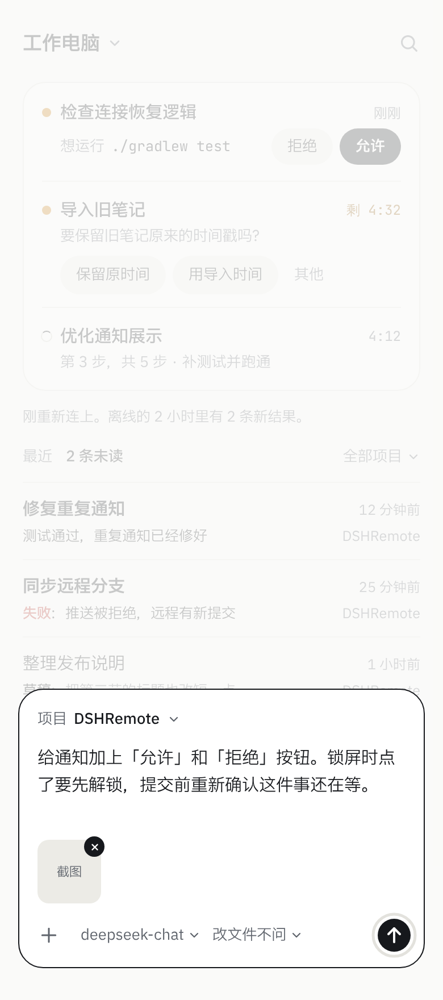

没有单独的页面。点首页底部的输入框，它原地展开，键盘弹出，后面的首页盖一层页面底色。点外面收起，已输入的内容保留。

展开的输入框从上到下：

1. `项目 <项目名>`，点了在这一行上方展开项目列表（6.10）。列表里是已有的项目、「不指定项目」，最后一项是「新建或导入项目」，进入现有的创建／导入流程。默认是上一次用的项目。
2. 任务内容。
3. 已添加的图片缩略图，56 见方，右上角一个移除按钮。
4. 加号、模型、审批方式、发送键。

点发送键就开始：创建会话，设置模型和审批方式（和默认不同时），发出第一条消息，然后进入这个会话。

### 7.7 切换电脑

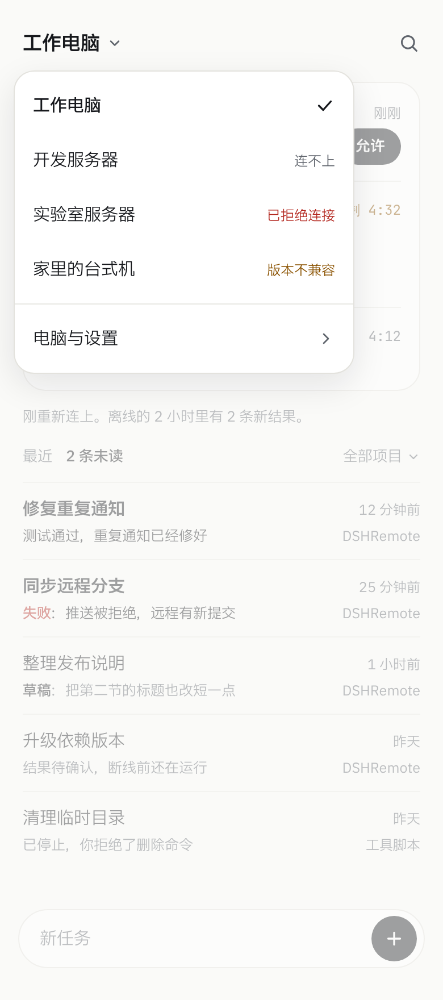

点首页左上角的电脑名，电脑列表在顶栏下面展开，首页其余的内容下移并变淡，电脑名旁边的小箭头朝上。规则见 6.10。列表每行高 48：

- 当前电脑：名字加粗，右边一个勾。
- 其他正常的电脑：只有名字，点了切换过去。
- 有问题的电脑：右边一个短状态。点了不切换，而是进它的详情页（7.9）。
- 分隔线下面一行「电脑与设置」，进 7.8。

短状态的文字：

| 连接状态 | 列表里 | 颜色 |
|---|---|---|
| 正在连 | 连接中 | 次要文字 |
| 连不上 | 连不上 | 次要文字 |
| 证书指纹不匹配 | 已拒绝连接 | 危险 |
| 需要重新配对 | 需要重新配对 | 等你（字） |
| DSH 版本不兼容 | 版本不兼容 | 等你（字） |
| App 版本太旧 | 需要更新 App | 等你（字） |

只配对了一台电脑时不展开列表：点电脑名直接进「电脑与设置」，电脑名旁边的小箭头换成朝右。

### 7.8 电脑与设置

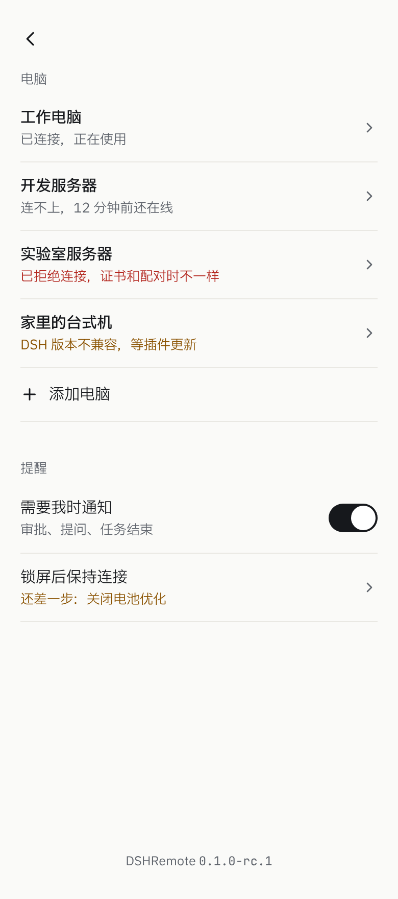

- **电脑**：每台一行，名字加一句状态，最右边一个小箭头，点了进详情。最后一行「添加电脑」。
- **提醒**：「需要我时通知」开关；「锁屏后保持连接」，还没设置好时下面用琥珀色字写差哪一步，点了进现有的引导。系统通知权限没开时，也在这里用同样的方式提示。
- **页面底部**：应用名和版本号。

### 7.9 单台电脑

- 名字，下面一行状态。
- 有问题时：一段话说明出了什么事、为什么这样处理，再给一个主按钮（重新配对、更新 App 等）。正常时没有这一段。
- 四行信息：名称（点了改名）、地址（点了修改）、记下的指纹、上次连上的时间。
- 最下面「移除这台电脑」，红字，点了先确认。

**证书指纹不匹配时只给「重新配对」，不提供任何继续连接的选项**（安全红线第 2 条）。

### 7.10 添加电脑

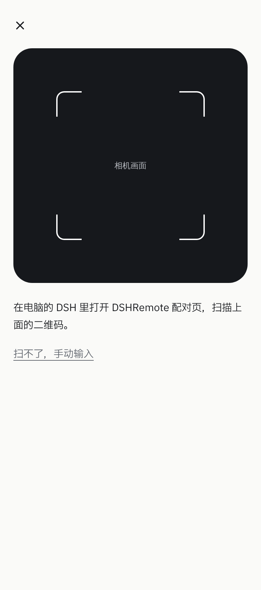

扫码这一步：取景框、一句说明、「扫不了，手动输入」。后面的核对指纹、手动输入、进行中、失败几步没有出稿，按同样的样式做，流程不变。

### 7.11 输入框展开与用量

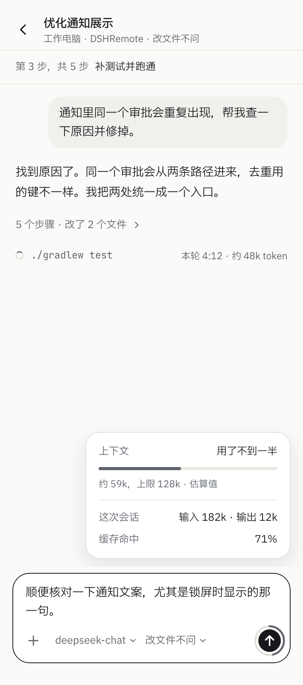

展开的输入框见 6.3。长按发送键，用量在输入框里、最下面一行的上方展开（规则见 6.10），再长按一次或点输入的文字收起。内容从上到下：

1. 「上下文」加一句人话：用了不到一半、用了一半左右、用了大半、快满了。
2. 一条细的用量条。
3. 「约 59k，上限 128k · 估算值」。
4. 分隔线。
5. 「这次会话」：输入和输出的 token 数。
6. 「缓存命中」：百分比。分母为零时这一行不显示。

拿不到的项目不显示，不要显示成 0。

### 7.12 计划

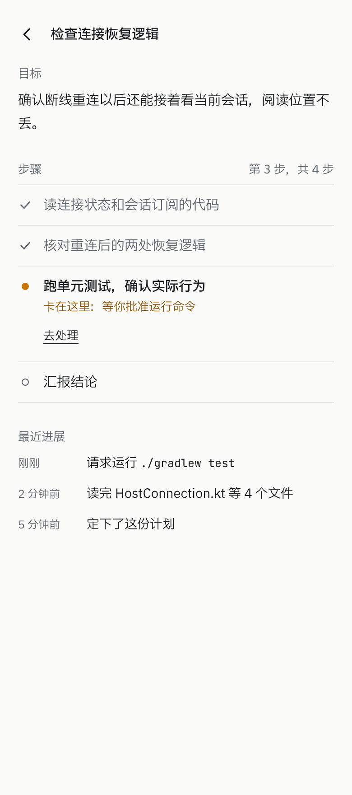

从计划条点进来。三段：

- **目标**：一段话。
- **步骤**：已完成的前面是灰色的勾，文字也是灰色；当前步骤前面是转圈标记，文字加粗；还没做的前面是空心圆。右上角写「第 3 步，共 4 步」。当前步骤卡住时，标记换成琥珀点，下面用琥珀色字写「卡在这里：」加原因；原因是等审批或等回答时，再给一个「去处理」。
- **最近进展**：时间加一句话，最新的在上。

全部以 DSH 的真实状态为依据，拿不到就不显示这一段。

### 7.13 对话分支

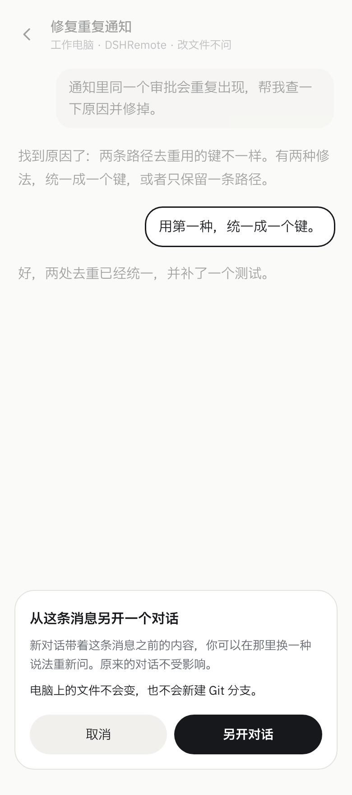

长按一条自己发的消息，底部出现一个面板，里面两行：「复制」和「另开对话」。不用贴着消息的浮动菜单。选「另开对话」后，这条消息加一圈主文字色描边，其余内容变淡，底部出现确认面板：标题、一段说明、一句「电脑上的文件不会变，也不会新建 Git 分支」、取消和「另开对话」。确认后进入新会话。

### 7.14 限时提问超时后

提问超时后，底部的面板消失，问题留在对话里它出现的位置：面板样式，第一行灰字「等了 5 分钟没有回答，DSH 先继续了」，然后是问题、一句「现在回答，它仍然会收到」和选项胶囊。回答之后这一块变成普通的一行记录。

这一屏还展示了上下文快满时的发送键。

## 8. 文案

- 用用户的话，不用内部名称：电脑（不说主机）、项目（不说工作区）、审批方式（不说权限模式）。
- 审批方式的三个名字：`read-only` 是「每次都问」，`workspace-write` 是「改文件不问」，`danger-full-access` 是「全部不问」。选择列表里可以在名字下面加一句说明。这三个名字要先对照 DSH 的实际行为确认；确认不了时沿用现在的「只读」「工作区写入」「完全访问」。
- 说发生了什么，再说能做什么。例：「证书和配对时不一样，已拒绝连接。」
- 时间用相对说法：刚刚、3 分钟前、1 小时前、昨天、周一。电脑和手机的时钟差照旧用 `ServerClock` 换算。
- 字符串全部放进 `strings.xml`。

## 9. 没有出稿的界面

下面这些没有画，按第 3 到 6 节的规则做，流程和现在一样：

- 空状态：还没配对电脑、还没有会话、筛选后没有结果。
- 加载和重连中的提示、历史分页的加载。
- 模型的选项列表（和审批方式是同一种样式，见 6.10）、创建／导入项目的目录浏览。
- 配对流程里扫码之后的几步。
- 多选和多个问题的提问。
- 各种确认对话框（移除电脑、停止任务等）。
- 通知的样式。
- 没有任何会话归属的独立处理页（从子代理事项的通知进来）：用 7.4、7.5 的面板，放在一个只有返回键的页面里。

## 10. 讨论过但没有采用的做法

不要再提出这些方案：

| 方案 | 没采用的原因 |
|---|---|
| 深色为主、琥珀加蓝的配色 | 颜色太多，用户要求干净、少色 |
| 滑动才能允许 | 审批很多，每次滑动太累 |
| 每页一个大标题 | 多余，页面内容已经说明了自己 |
| 首页按项目展开会话的目录树 | 同一件事出现两次，要点进去才能处理 |
| 单独的「新任务」页 | 和会话里的输入框是两套东西 |
| 单独的会话信息与用量页 | 用量应该随时看得到，不该藏在一页里 |
| 发送键旁边单独放一个上下文圆环 | 合并进发送键，少一个控件 |
| 浮在上面的菜单、居中的选择对话框 | 真机上会抢走输入焦点让键盘收起，还会和触发它的控件互相遮挡（6.10） |
| 手机上的 Git 提交与撤销 | 直接让 Agent 做，见 `roadmap.md` |
| 审批面板上的「这个会话里不再询问」 | DSH 的审批只对一次有效，没有接口支持 |
